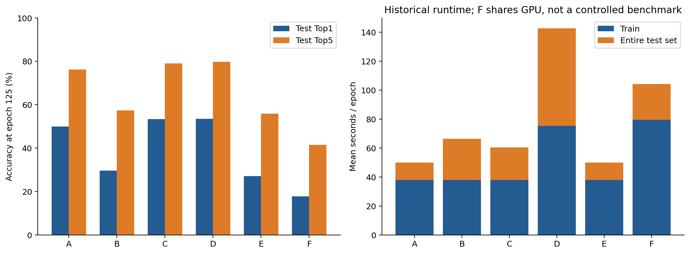

# YOLO & Foveated Vision Research

[中文](README.zh-CN.md) · [Complete tables](docs/en/tables.md) · [Historical document index](docs/en/archive_index.md) · [Evidence manifest](results/evidence_manifest.csv)

This repository documents the complete recorded research sequence: YOLO26 dual-head supervision, cross-domain YOLOv8n baselines, target-protected background blur, VisDrone feature smoothing and foveated inference, CUB-200-2011 image representations, global/local classification and a stopped normalization experiment. It contains positive signals, negative results, implementation audits and incomplete work—not a claim of a finished state-of-the-art method.

## Principal results

| Experiment | Matched reference | Result | Interpretation |
|---|---|---|---|
| YOLO26 projected O2M→O2O transfer, 50 epochs | B50, seeds 42 / 0 | AP95 changes **+0.670 / −0.215 points** | Single-seed gain did not reproduce; route stopped |
| Assignment-stability augmentation controller | Instrumented fixed-strength A0 | **50.847% vs 51.357% AP95** | Mechanism probe passed; training benefit did not |
| Cross-domain YOLOv8n scratch baselines | 11 dataset versions × 2 seeds × 125 epochs | **22/22 runs completed and audited** | Reference suite, not 22 proposed improvements |
| Learned safe-background blur, VOC dev1655 | Identical initialization, 125 additional epochs | **49.5201% vs 50.0451% AP95** | Negative, with ~1.9× measured prediction latency |
| SET HBS-only port, VisDrone val548 | Identity extra-loss, same 125 epochs | **21.4733% vs 22.9070% AP95** | Negative; not a reproduction of full SET |
| Frozen detector + adaptive four crops | Single full-image pass | **22.6803% vs 23.0872% AP95** | More model calls, lower AP; current prototype rejected |
| CUB native500 original / GT background removal / GT background blur | Scratch ResNet50, seed2005, epoch125 | **49.9655 / 53.3310 / 53.4518% Top1** | Positive **Oracle** representation evidence; test boxes are required |
| CUB global+crop / blank+crop, shared ResNet50 | Same two-GPU protocol, epoch125 | **52.2782 / 64.6876% Top1** | Global branch was not beneficial in this implementation; BN confounding remains |
| Separate per-view BN statistics (G6) | Intended G4 ablation | **Stopped by user at epoch50** | No completed 125-epoch conclusion; GPU6 restart was not launched |

AP95 means mAP at IoU 0.50:0.05:0.95. It is not the historical VOC2007 AP definition. Detection splits, checkpoint selection, heads and evaluators differ between rows; these rows are **not** a cross-dataset leaderboard. Classification percentages and AP points have different meanings.

## Research chapters

1. [YOLO26: baseline, supervision, gradients, assignment and causal screening](docs/en/01_yolo26.md)
2. [Dataset acquisition, quality audit and 22 cross-domain baselines](docs/en/02_datasets.md)
3. [VOC: differentiable blur, Oracle controls and the 125-epoch learned frontend](docs/en/03_voc_blur.md)
4. [VisDrone: resolution, SET-HBS, foveation, false positives and target protection](docs/en/04_visdrone.md)
5. [CUB: dataset profile, exact A–F transformations and complete results](docs/en/05_cub.md)
6. [CUB global/local inputs, shared BN, G4/G5 results and G6 stop](docs/en/06_global_local_bn.md)
7. [Engineering, evaluation rules, reproducibility and limitations](docs/en/07_reproducibility.md)
8. [Chronology, delivered artifacts and remaining unperformed experiments](docs/en/08_progress.md)
9. [Literature, adoption boundaries and research implications](docs/en/09_literature.md)

## Data and implementation

- [Canonical run registry](results/training_run_registry.csv): every collected server training CSV, including engineering smoke and stopped runs, without counting local snapshots as new experiments.
- [All canonical epoch curves](results/all_canonical_epoch_curves.csv): original loss, learning-rate, AP and accuracy fields; 6,056 recorded epoch rows across 96 CSVs at publication.
- [22-run endpoints](results/dataset_22_run_endpoints.csv), [CUB endpoints](results/cub_primary_and_secondary_endpoints.csv), [JSON metric ledger](results/detection_metric_ledger.csv), [classwise AP ledger](results/detection_classwise_ledger.csv), [TP/FP and coverage counts](results/diagnostic_counts_ledger.csv).
- [Source code index](results/code_index.csv), [original 38.5K-parameter differentiable PGB prototype](code/original_pgb_core), [classification trainers/transforms/audits](archives/remote/classification/src), [blur models and tests](archives/remote/progressive_blur/pgb), [early YOLO26 research code](code/historical/yolo26_research).
- [374 historical research Markdown records](docs/en/archive_index.md) retain the development history, excluding unrelated upstream framework documentation. Early plans and live status snapshots can be superseded; current chapters identify final audits and stop records.
- [21 source-indexed figures, PNG + SVG](docs/en/figures.md) accompany the underlying CSV/JSON evidence. [Build script](tools/build_report.py) regenerates the derived tables and plots; it does **not** launch training.

Raw datasets, pretrained/checkpoint binaries, private credentials and third-party paper PDFs are not redistributed. Large per-object FCA tables and frozen-detector prediction records are preserved as compressed numerical evidence; consult the [publication scope](PUBLICATION_SCOPE.md) and [licensing notice](LICENSING.md).

## Status and claim boundary

A–F and G4/G5 classification runs are complete. G6 is deliberately stopped at 50 epochs. No new experiment was launched for this publication. Repeatedly inspected test/development sets, single-seed classification, runtime changes and hardware-error history limit generalization claims. Oracle preprocessing uses evaluation boxes and is not deployable annotation-free inference. The strongest completed positive observation is the CUB representation/local-crop signal; neither a publishable new algorithm nor a reliable compute-saving model has been established.
