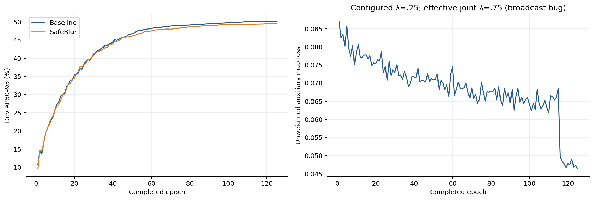
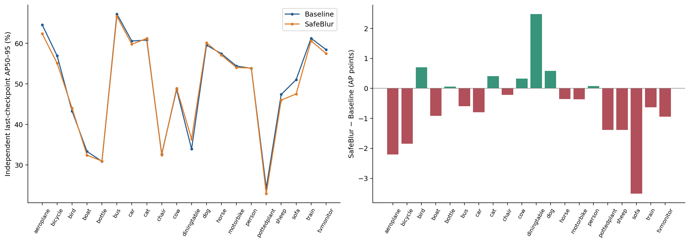

# 3. VOC: target protection and spatial background blur

[Contents](../../README.md) · [中文](../zh-CN/03_voc_blur.md)

## Initial question and differentiable core

The initial idea was to retain target boxes and nearby context while attenuating distant high-frequency texture, leaving the YOLOv8n architecture unchanged. It was generic multi-object detection, not low-light restoration, segmentation or sequential single-target search. The input/output tensor remained RGB at the same spatial resolution; blur alone cannot reduce the detector's FLOPs.

The user-supplied prototype contained a **38,513-parameter** predictor, continuous box-distance supervision, a differentiable multiscale Gaussian renderer, balanced auxiliary loss and YOLO batch-coordinate conversion. CPU checks covered protected pixels, interpolation partition, backpropagation, empty labels, state serialization and 640 input. Later work integrated the frontend into a registered module/custom trainer, aligned transformed boxes and masks, included parameters in optimizer/EMA/checkpoint/resume, and used the same frontend in validation and prediction. [Original code and tests](../../code/original_pgb_core), [P0 protocol](../../archives/local/voc_pgb_yolov8n/P0_IMPLEMENTATION_PROTOCOL.md), [implementation and tests](../../archives/remote/progressive_blur/pgb).

For box $i$ with center $(c_x,c_y)$, width$w_i$, height$h_i$, margin$m=.1$, the implementation used

$$\Delta x_i=\max(|x-c_x|-(.5+m)w_i,0),\quad\Delta y_i=\max(|y-c_y|-(.5+m)h_i,0),$$
$$r_{x,i}=\max(.5w_i,8),\quad r_{y,i}=\max(.5h_i,8),\quad d^2(x,y)=\min_i[(\Delta x_i/r_{x,i})^2+(\Delta y_i/r_{y,i})^2],$$
$$S^*(x,y)=1-\exp[-d^2(x,y)/2].$$

The union of expanded boxes has target0; far background approaches1. Pixel centers and half-open geometry are explicit. Padding and configured ignore/difficult regions are excluded from auxiliary supervision; an empty annotation is **not** assumed to prove pure background. Gaussian levels0/1/2/4/8 are blended continuously, then mixed with the original image, initially with$\rho=0$, ramping toward 0.5. This is interpolation of filtered images, not an exact per-pixel dynamic Gaussian kernel or optical depth-of-field model.

For initial protected/background sets$P_n,B_n$ in image$n$, SmoothL1 with$\beta=.1$ was averaged separately over each present region and then over supervised images:

$$L_{map}=\frac1{N_{sup}}\sum_n\frac1{|\mathcal R_n|}\sum_{R\in\mathcal R_n}\frac1{|R|}\sum_{p\in R}\operatorname{SmoothL1}_{.1}(\hat S_p-S^*_p).$$

This avoids the much larger background area dominating the map loss. It is continuous strength regression, not an instance segmentation loss. A small scalar loss does not imply a small parameter gradient; auxiliary weight decisions require checking reduction, gradient scale and detector performance.

## 20-epoch controlled experiments

VOC trainval was split by seed 2027 into14,896 training and 1,655 development images. Scratch YOLOv8n,20 epochs,640, batch 64 and a deliberately controlled/weak augmentation configuration were used. These runs tested mechanisms cheaply before a stronger long-budget conclusion.

| Run | Image at training | Image at evaluation | P | R | AP50 | AP95 |
|---|---|---|---:|---:|---:|---:|
| Original baseline | Raw | Raw |0.42630|0.29020|0.29178|0.16173|
| Learned PGB | Predicted blur | Predicted blur |0.39286|0.31732|0.29113|0.15921|
| GT Oracle blur | GT-box protected blur | GT-box protected blur |0.38119|0.33975|0.30918|0.17042|

These rows are development-selected best training-validator values, not fixed-last independent reevaluation. Fixed20 AP95 was0.14023 original vs0.13711 learned. Runtime312.328 vs738.908s (2.366×). Initial Oracle improvement did not demonstrate a learned/deployable method. [P1 results](../../archives/local/voc_pgb_yolov8n/P1_ORACLE_COMPARISON.json).

The extreme blackout experiment retained GT boxes and made their exterior black at training and Oracle evaluation. Masked-image AP95 was0.44016; evaluating that best checkpoint on **raw** development images gave0.01418, last gave0.01394, compared with raw baseline0.161691. It is a strong distribution-shift/privileged-location result, not evidence that blackout helps real inference. Failed NUMA1 SIGBUS starts were invalid; the successful NUMA0 run is recorded separately.

Next, GT blur was used **only during training**, with raw validation/inference and no frontend. Independent raw best-checkpoint results:

| Training input | P | R | AP50 | AP95 |
|---|---:|---:|---:|---:|
| Raw baseline |0.410728|0.295163|0.290927|0.161691|
| Weak Oracle blur |0.359327|0.329336|0.288983|0.161312|
| Strong Oracle blur, all images |0.393578|0.305876|0.288812|0.157440|
| Strong Oracle blur, probability0.5 |0.405032|0.298566|0.289761|0.161610|

The stronger bank used0/2/4/8/16, mixture0.5, first 5 epochs off and next 5 ramp. These controls found no convincing raw-image generalization gain. Their full per-class and checkpoint-selection records are in the [metric ledger](../../results/detection_metric_ledger.csv) and [P1 sources](../../archives/remote/progressive_blur/runs/voc_p1).

## Conservative learned frontend: pilots and 125-epoch pairing

The later safe-background model predicts a conservative **blur permission** map from images alone, not test GT. It uses a larger ~0.960M-parameter predictor rather than the early0.0385M prototype. Map-only warmup, frozen-detector feedback and 10%-data joint pilots were implemented and tested before formal pairing. They are engineering/diagnostic pilots, not substitutes for the full result.

Its auxiliary objective is **not** the initial balanced SmoothL1. With predicted permission$p$, protected set$P$, and far-background set$F=\{S^*\ge.8\}\setminus P$, each image contributes $4\,\operatorname{mean}_{P}[-\log(1-p)]+.25\,\operatorname{mean}_{F}[-\log p]$. Present images are averaged; the transition band and empty-label images are ignored. Probabilities are clamped to$[10^{-6},1-10^{-6}]$ and logarithms are evaluated inFP32. The asymmetric4/.25 weights strongly discourage target blur while weakly encouraging far-background use. These **internal regional weights** differ from the outer joint coefficient discussed below. [Actual gate-loss source](../../archives/remote/progressive_blur/pgb/safe_background.py).

Both formal arms started from the same previously trained scratch20-epoch detector checkpoint and each received **125 additional detector epochs**. The method also had five map-only warmup epochs with the detector frozen. Detector initialization was checked tensor-by-tensor. The budget must not be described as two independent scratch125 baselines or ignored extra frontend warmup.

Shared settings: seed 2027, train 14,896/dev1,655,640, batch 64, AdamW, initial LR0.0005, cosine schedule, physical GPU0–3/NUMA0. The detector was unchanged except its input image; all inference locations were chosen by the learned permission map. [Frozen protocol](../../archives/local/voc_pgb_yolov8n/SAFE_BACKGROUND_LONG_E125_PROTOCOL_2026-09-24.md).

### Important loss defect retained in the record

The configured auxiliary coefficient was0.25, but a scalar auxiliary term was broadcast into the three-component detector loss vector before summation. Therefore the actual joint coefficient was **3×0.25=0.75**, not0.25. This is a verified implementation deviation. Historical numbers were not edited or relabeled as a clean lambda0.25 experiment. Any future corrected-coefficient comparison would be a new experiment.

### Matched independent last-checkpoint evaluation

| Epoch125, independent FP32 | P | R | AP50 | AP95 | Derived H(P,R) |
|---|---:|---:|---:|---:|---:|
| Original matched baseline |0.746594|0.633446|0.701927|0.500451|0.685381|
| Safe-background blur |0.758914|0.618161|0.696393|0.495201|0.681344|

AP95 difference **−0.005251 (−0.5251 AP points)**: **no-go**. Training CSV values0.50062/0.49529 are not silently substituted for independent values. Thirteen classes decreased and seven increased; sofa−3.51 AP points and diningtable+2.48 exemplify different responses. [Complete20-class comparison](../../results/voc125_classwise.csv).

### Protection and paired detections

At least95% of a GT box's pixels with permission≤0.1 defined “safe.” Overall3,524/3,882 targets (90.78%) were safe: small93/101 (92.08%), medium871/927 and large2,560/2,854. Mean permission inside protected pixels≈0.0205; far background≈0.3824, with 55.95% above0.25 and 37.41% above0.5. Not all background was heavily processed.

At fixed confidence0.25 / IoU0.5,2,576 GT were detected by both models,147 only by baseline,139 only by method and 1,020 by neither. Small-target baseline-only/method-only were4/3. This does **not** prove that large-scale small-target destruction explains the AP loss. Disabling the learned model's blur at evaluation gave AP95=0.494941 vs0.495201 with mixture0.5: current rendering added only 0.026 AP point within that trained model, and neither matched the original baseline.

### Cost and final interpretation

Training consumed12,196.8 vs1,986.75s (~6.14×). On128 predecoded images/batch 16, median full prediction latency was4.400 vs2.333ms/image (~1.9×). Validator forward-only timing2.534 vs0.695ms has a different scope. Parameter counts were3.970M vs3.010M; reported15.4 vs8.1GFLOPs omit some Gaussian operations and cannot be treated as complete end-to-end cost.

The route failed the tested deployment trade-off. That conclusion is bounded by single seed, repeatedly used development set,20-epoch starting detector, auxiliary reduction defect and hardware history; it does not logically disprove every possible background attenuation strategy. **No VOC blind test improvement or novel publishable blur detector was established.** [Strict final report](../../archives/local/voc_pgb_yolov8n/SAFE_BACKGROUND_LONG_E125_FINAL_RESULT_2026-09-24.md).
