# Figures and source data

English labels are shared between editions. Detection AP is scaled to percent; deltas are percentage points. No experimental observations, unsaved confidence intervals or new training are synthesized.

## CUB A–F test accuracy and losses

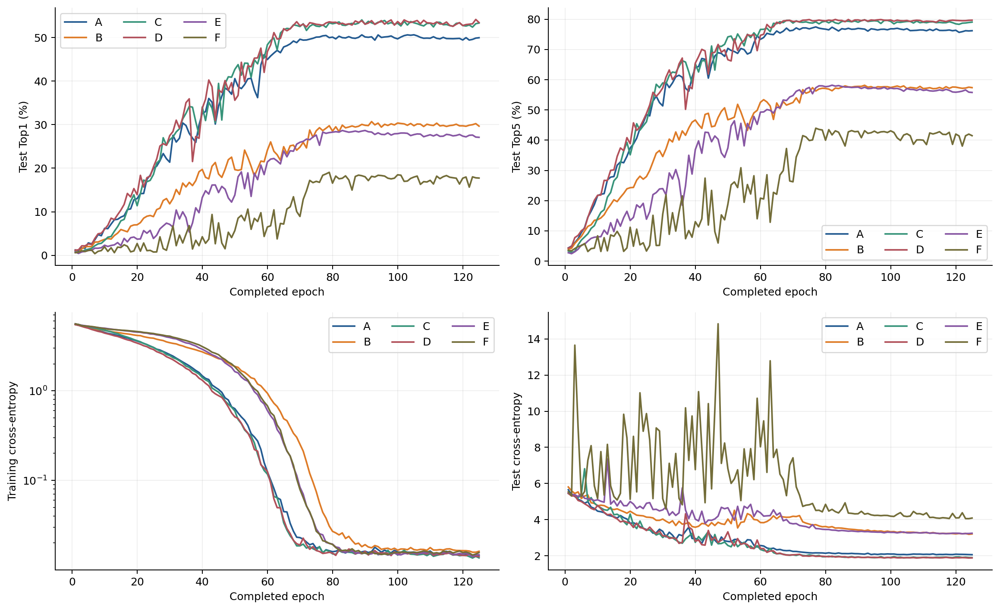

[SVG](../../figures/cub_A_F_learning_curves.svg) · [Source](../../results/cub_primary_and_secondary_endpoints.csv)

## CUB fixed125 endpoints and historical epoch cost

[SVG](../../figures/cub_A_F_endpoints_and_cost.svg) · [Source](../../results/cub_primary_and_secondary_endpoints.csv)

## G4/G5 and incomplete G6 trajectories

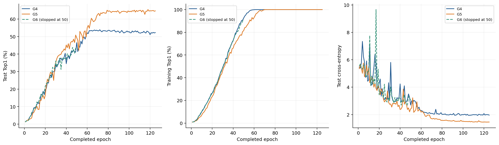

[SVG](../../figures/cub_global_local_and_incomplete_bn.svg) · [Source](../../results/cub_primary_and_secondary_endpoints.csv)

## All200 CUB classes, train/test counts

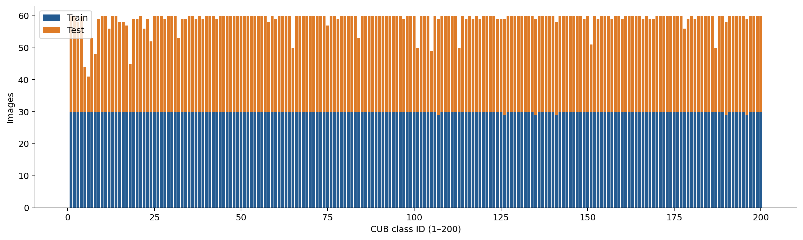

[SVG](../../figures/cub_class_distribution.svg) · [Source](../../results/cub_all_200_class_counts.csv)

## 22 scratch detection baselines

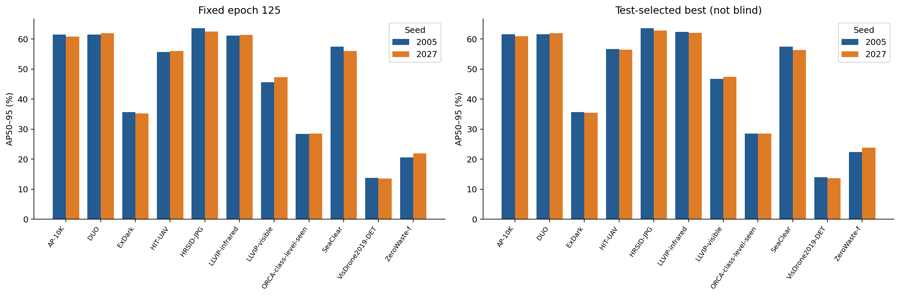

[SVG](../../figures/dataset_22_baseline_endpoints.svg) · [Source](../../results/dataset_22_run_endpoints.csv)

## YOLO26 short-budget controls, seeds42/0; truncated axis

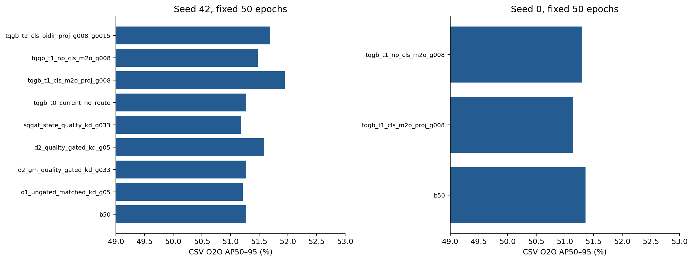

[SVG](../../figures/yolo26_short_ablation_endpoints.svg) · [Source](../../results/yolo26_run_endpoints.csv)

## YOLO26 baseline/gain-zero trajectories, different validation heads

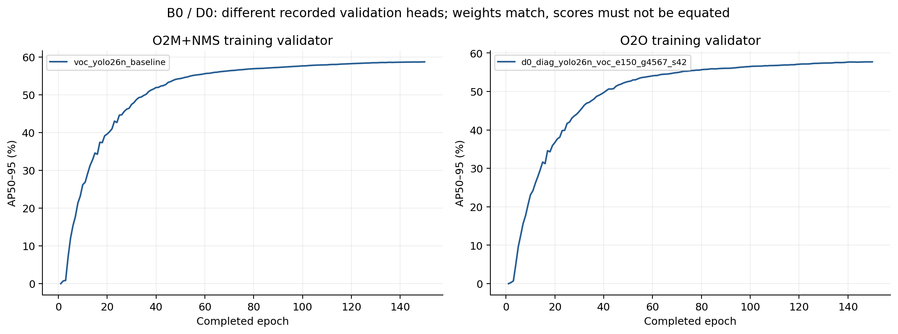

[SVG](../../figures/yolo26_150_baseline_reproduction.svg) · [Source](../../results/yolo26_run_endpoints.csv)

## ASAC A2/A0 AP and actual q

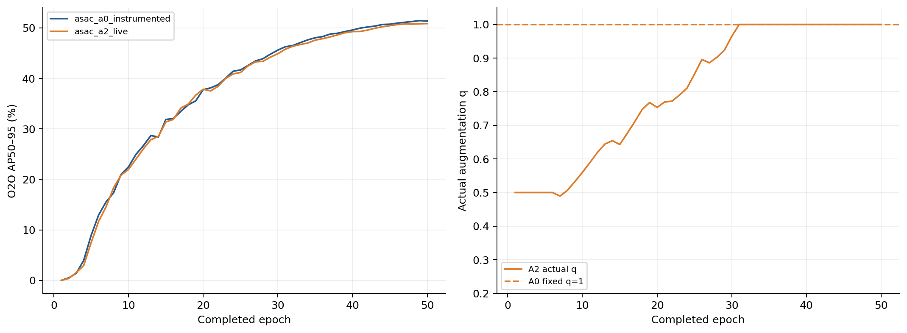

[SVG](../../figures/asac_paired_training.svg) · [Source](../../results/asac_controller_epoch_states.csv)

## VOC independent20-class AP difference

[SVG](../../figures/voc125_classwise.svg) · [Source](../../results/voc125_classwise.csv)

## HBS independent10-class comparison

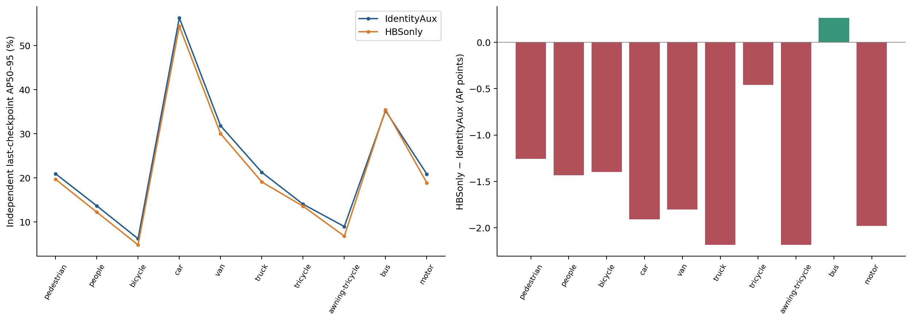

[SVG](../../figures/visdrone_hbs_classwise.svg) · [Source](../../results/visdrone_hbs_classwise.csv)

## VOC long-run AP and auxiliary map loss

[SVG](../../figures/voc125_curves_and_map_loss.svg) · [Source](../../results/all_canonical_epoch_curves.csv)

## Three-strength inference, GT/predicted protection

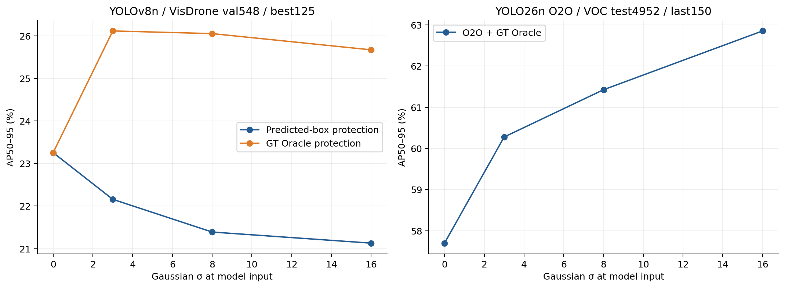

[SVG](../../figures/testtime_blur_GT_vs_prediction.svg) · [Source](../../results/detection_metric_ledger.csv)

## Foveation endpoints; truncated axis

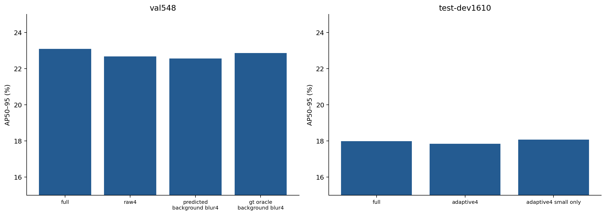

[SVG](../../figures/foveation_val_and_testdev_endpoints.svg) · [Source](../../results/foveation_same_protocol_endpoints.csv)

## Per-class fixed-threshold true/false positives

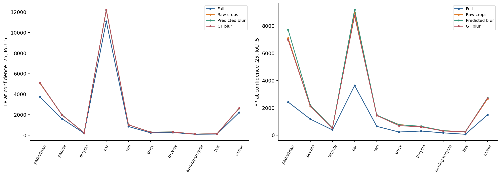

[SVG](../../figures/foveation_TP_FP_by_class.svg) · [Source](../../results/foveation_fixed_threshold_classwise_TP_FP.csv)

## CUB train accuracy and generalization gap

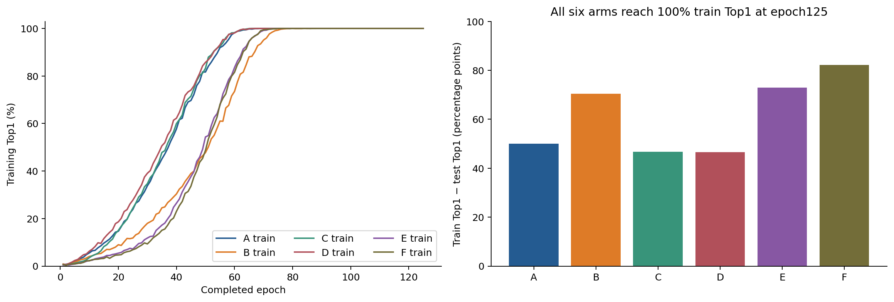

[SVG](../../figures/cub_train_accuracy_and_generalization_gap.svg) · [Source](../../results/cub_primary_and_secondary_endpoints.csv)

## Synthetic rectangular protection geometry, NOT an experimental image

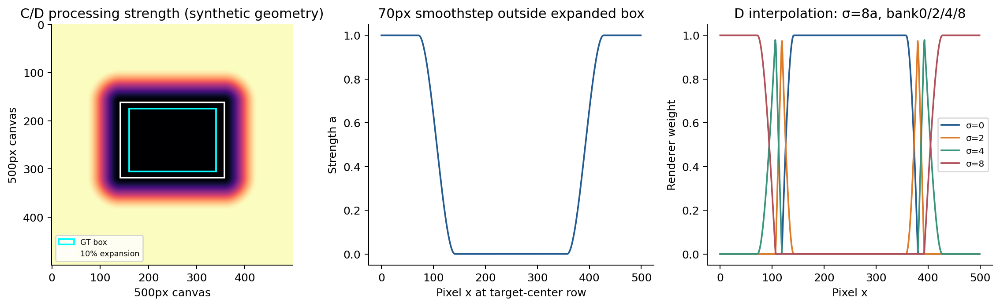

[SVG](../../figures/cub_protection_geometry_illustration.svg) · [Source](../../tools/build_extended_figures.py)

## Implemented input/model/GT pathways

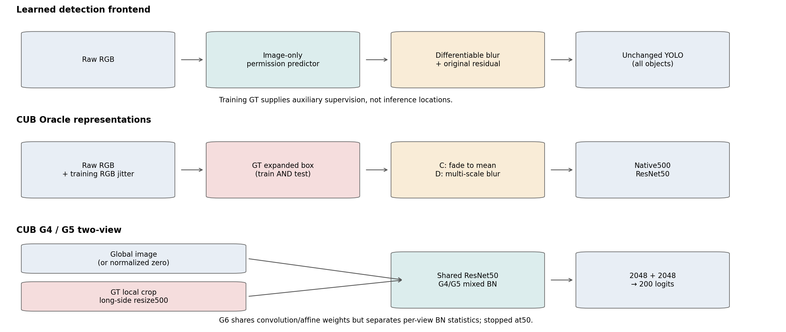

[SVG](../../figures/implemented_method_pipelines.svg) · [Source](../../docs/en/03_voc_blur.md)

## Target protection and background permission

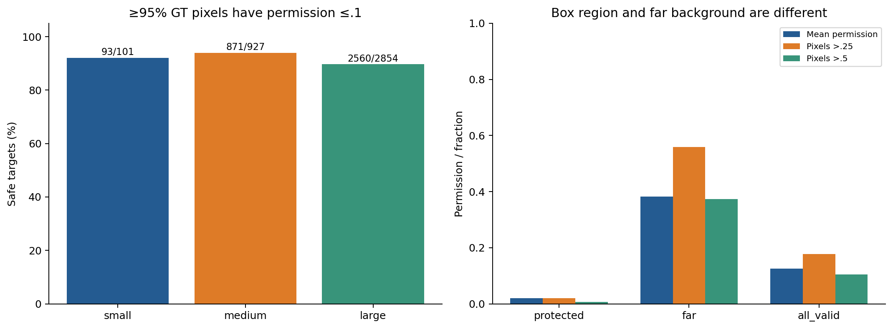

[SVG](../../figures/voc_gate_protection_and_permission.svg) · [Source](../../results/voc_gate_size_protection.csv)

## HBS AP curves and size-specific recall

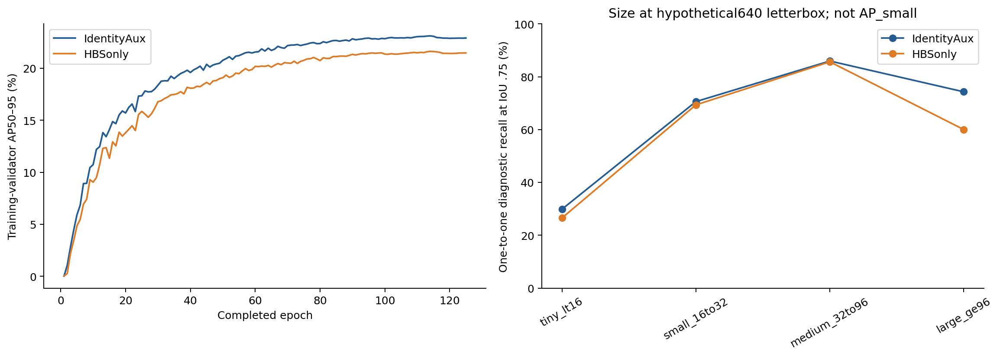

[SVG](../../figures/hbs_learning_and_size_recall.svg) · [Source](../../results/hbs_size_recall.csv)

## Mask protection and area transfer, eligible targets only

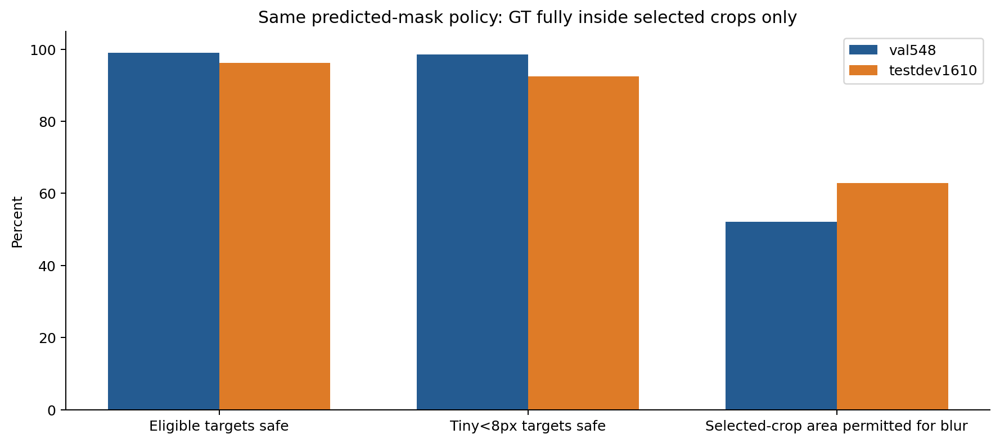

[SVG](../../figures/foveation_mask_val_test_transfer.svg) · [Source](../../results/foveation_mask_transfer_counts.csv)

## FCA full coverage audit and go/no-go threshold

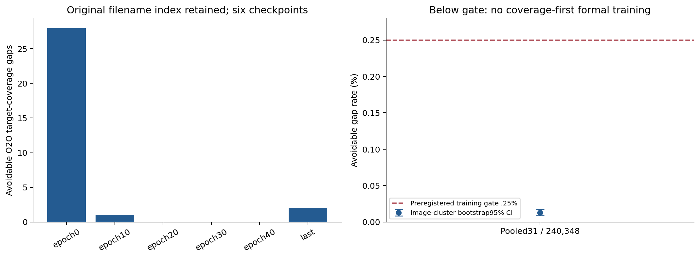

[SVG](../../figures/fca_coverage_gap_screening.svg) · [Source](../../results/fca_o2o_checkpoint_coverage_gap.csv)

